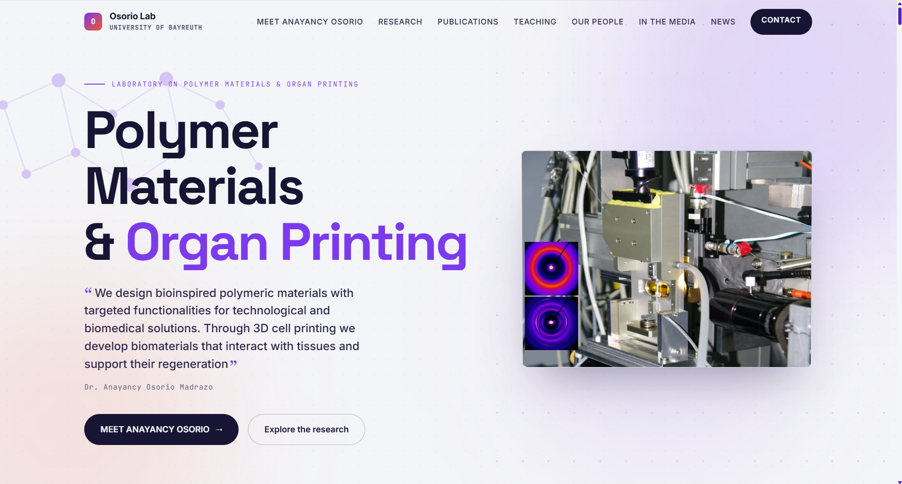

<p align="center">
  
</p>

# Osorio Lab — Laboratory Website

Production website for the **Laboratory on Polymer Materials & Organ Printing** (Prof. Dr. Anayancy Osorio-Madrazo, University of Bayreuth), live at [osorio-research.com](https://osorio-research.com).

Built with vanilla **TypeScript** compiled to plain JavaScript — no framework, no bundler at runtime, no server-side rendering. The entire editable surface — 46 publication entries, 15 team members, 18 alumni, 20 research topics and 64 UI strings — is driven by a single `content.json` file, so non-technical staff can update the site without touching code.

[](https://www.typescriptlang.org/)
[](https://animejs.com)
[](#built-with)
[-blue)](#built-with)

## Built With

- **TypeScript** (strict mode) — sources in `assets/ts/`, compiled to the plain JS the browser loads.
- **Vanilla DOM** — rendering, templating and state are hand-rolled; no framework runtime.
- **anime.js 3.2.1** (CDN) — the only external runtime dependency.
- **CSS3** — single hand-written stylesheet, no preprocessor.
- **JSON** — `content.json` as the single content source, validated against TS interfaces at build time.

## Features

- **Content-driven rendering** — every section renders from `content.json` (fetched at runtime with `cache: "no-store"`), falling back to the `data.js` seed compiled from `data.ts` if the fetch fails.
- **Typed content contract** — `LabData`, `Publication`, `TeamMember` and `TeachingPeriod` interfaces in `data.ts` document the exact JSON shape; a typo in the content breaks `npm run build`, not production.
- **Runtime i18n overlay** — 64 UI string keys (`window.I18N`), overridable per language from the same JSON via the `i18n` field.
- **Compiled-output parity** — the TS→JS translation was verified with a real-browser probe that compared the old JS and the new compiled JS on rendered DOM state and interactions (result: identical, zero page errors).
- **SEO as code** — JSON-LD `@graph` generated at runtime for all 46 publication entries (`ScholarlyArticle` / `Chapter` / patent), plus static Organization / Person / WebSite entities, Open Graph, Twitter cards, `sitemap.xml`, `robots.txt` and `llms.txt` for AI search engines.
- **Accessibility** — `prefers-reduced-motion` short-circuits every animation; focus-trapped team modal with Escape/Tab handling; ARIA labels resolved through the i18n layer.
- **Image pipeline** — 19 WebP images with JPG fallbacks, lazy loading, on-error avatar fallback generated from member initials, and `?r=` cache-busting retries.
- **XSS hardening** — all content interpolated through an HTML escaper; `safeUrl()` whitelists `http(s)`, `mailto:` and `tel:`, and blocks `javascript:`/`data:` schemes.

## Project Structure

```text
index.html              single page — loads 3 scripts, zero inline logic
content.json            editable content (what the site owner maintains)
assets/
├── ts/                 TypeScript sources
│   ├── data.ts         content seed + typed content model
│   ├── main.ts         rendering, i18n, animations, modal, SEO
│   ├── early.ts        JS-availability guard (prevents FOUC)
│   └── globals.d.ts    ambient typings for the anime.js CDN
├── js/                 compiled output (what the browser loads)
│   ├── data.js         ← data.ts
│   ├── main.js         ← main.ts
│   └── early.js        ← early.ts
├── css/styles.css      single stylesheet
└── img/                optimized WebP + JPG fallbacks
```

## Data Model

`content.json` mirrors the `LabData` interface — the full contract the owner edits:

```ts
interface LabData {
  publications: {
    articles: Publication[];  // 43 peer-reviewed
    chapters: Publication[];  // 2 book chapters
    patents: Publication[];   // 1 PCT/EP/US
  };
  team: TeamMember[];         // 15 members (photo, bio, socials)
  alumni: string[];           // 18 former members
  topics: string[];           // 20 research keywords
  teaching: TeachingPeriod[]; // grouped by degree program
  media: MediaItem[];         // press, interviews, TV
  i18n?: Record<string, string>; // overrides for the 64 UI keys
}
```

Optional fields degrade gracefully: a team member without `img` renders an initials avatar; without `bio`, the modal hides the paragraph; a publication without `url` drops the DOI link.

## Getting Started

**Prerequisites:** Node.js 18+ (build only — the site itself needs no Node) and any static file server for local preview.

```bash
git clone https://github.com/RedBagDude/osorio-lab.git
cd osorio-lab
npm install     # installs the TypeScript compiler
npm run build   # tsc: assets/ts/*.ts -> assets/js/*.js
npm run watch   # recompiles on save
```

**Preview locally** (any static server works — the deploy target is plain FTP):

```bash
python -m http.server 3000
# open http://localhost:3000
```

**Deploy:** upload everything except `node_modules/`, `assets/ts/` and `tsconfig.json`. When shipping new JS, bump the `?v=` cache-busters on the `<script>` tags in `index.html`.

## Performance

- **~89 KB of JavaScript total** (uncompressed) across 3 files — no framework, no polyfills.
- **1 CDN request** (anime.js) — everything else is same-origin.
- Scroll animations are seek-driven, not replay-driven: scrub timelines to viewport progress instead of firing on intersection, so scrolling up reverses them with no reflow.
- Ambient loops (blobs, rings, dots) are gated by `(max-width: 760px)` and `prefers-reduced-motion` to cap GPU cost on mobile.

## Acknowledgements

- [anime.js](https://github.com/juliangarnier/anime) by Julian Garnier — motion engine.
- Content © Laboratory on Polymer Materials & Organ Printing, University of Bayreuth.
- Site developed for the Osorio Lab by [Jonathan Martínez López](https://github.com/RedBagDude).

## Maintenance Notes

The day-to-day surface of this site is deliberately small: nearly every routine update belongs in `content.json`, while the TypeScript sources only need attention when the shape of that data changes or when rendering, internationalization, animation or SEO behavior is adjusted.

Keep the seed in `data.ts` in step with any structural change to the JSON. It is both the fallback used when the runtime content fetch fails and the definition of the typed content contract, so drift between the two shows up as inconsistent behavior rather than an obvious error.

Prefer editing existing values over adding new fields. The optional ones are the safest path for partial information: a team member without a photo, bio or social link, and a publication without a link, all degrade gracefully instead of breaking the layout.

Because a mistyped value fails the build rather than production, run the build after every content change and only upload once it passes. Deployments stay a plain file upload — ship everything except the build-only folders and configuration file — and whenever the compiled JavaScript changes, also bump the cache-busting identifiers on the script tags so returning visitors do not mix a fresh bundle with a stale one.
